# OpenShift における Secret 管理と External Secrets Operator (ESO) について

## 要旨

- **提案**: Secret の値を、アプリチームが OpenShift 上に直接作って保管するのではなく、外部のシークレットストア (保管庫) に一本化し、External Secrets Operator (ESO) が OpenShift 内の Secret へ自動で同期する方式を標準とする。
- **狙い**: 値の管理元を保管庫の 1 か所にすることで、値の拡散を防ぎ、更新 (ローテーション) を 1 か所の変更で済ませ、誰がどの値にアクセスできるかを保管庫側で一元管理できるようにする。
- **検証状況**: ROSA + AWS Secrets Manager、OpenShift on OCI + OCI Vault の 2 構成で、同期と、保管庫側の値の更新への追従まで実機で確認済み (5 章)。確認中の事項 (OCI の Workload Identity による認証など) は、本文中にその旨を明記している。

### 本説明のゴール (今回お願いしたいこと)

今回は **何かを決定・承認いただく場ではない**。次の 3 点が共有できればゴールとする。

1. Secret を「設定」ではなく「鍵」として管理する必要性と、標準 Secret 方式の限界 (1・2・4 章) を理解いただくこと。
2. ESO 方式の仕組みと、従来方式との違い (3・4 章) を理解いただくこと。
3. 残っている検討事項 (値の受け渡し方法は 6.2、アプリ間の権限の分け方は 6.3、OCI の認証方式は 5.2) の存在と、今後の進め方のイメージを共有すること。

個別の方式決定は、今回のご意見・ご質問を踏まえて次回以降に提案する。ご不明点は、その場で分かる範囲でお答えし、分からないものは検討事項として持ち帰る。

## 目次
- [要旨](#要旨)
- [1. Secret とは、なぜ管理が必要か](#1-secret-とはなぜ管理が必要か)
  - [1.1 Secret を変更するユースケース](#11-secret-を変更するユースケース)
  - [1.2 この仕組みで誰がどう嬉しいか](#12-この仕組みで誰がどう嬉しいか)
- [2. OpenShift での Secret 管理の方法](#2-openshift-での-secret-管理の方法)
- [3. ESO の仕組み](#3-eso-の仕組み)
- [4. 方式の比較 (メリット・デメリット)](#4-方式の比較-メリットデメリット)
- [5. 導入手順 (実機検証済みの流れ)](#5-導入手順-実機検証済みの流れ)
  - [5.1 ROSA 版 (保管庫: AWS Secrets Manager)](#51-rosa-版-保管庫-aws-secrets-manager)
  - [5.2 OCI 版 (保管庫: OCI Vault / OpenShift on OCI)](#52-oci-版-保管庫-oci-vault--openshift-on-oci)
  - [5.3 環境による違い (要点)](#53-環境による違い-要点)
  - [5.4 OpenShift 上で作成するリソースとスコープ](#54-openshift-上で作成するリソースとスコープ)
- [6. 役割分担と運用設計 (案)](#6-役割分担と運用設計-案)
  - [6.1 作業ごとの担当](#61-作業ごとの担当)
  - [6.2 Secret の値の受け渡し方法](#62-secret-の値の受け渡し方法)
  - [6.3 権限の設計 (OCI + Workload Identity の案)](#63-権限の設計-oci--workload-identity-の案)
  - [6.4 運用フロー (案)](#64-運用フロー-案)
- [付録: 参照ドキュメント](#付録-参照ドキュメント)

## 1. Secret とは、なぜ管理が必要か

**Secret** = パスワード、API キー、証明書の秘密鍵、トークンなど、システムやデータへのアクセスに使う機密情報。第三者に知られると、不正アクセスやなりすましにつながる。

Secret はアプリケーションの「設定」ではなく「鍵」である。アプリ本体とは性質が異なる。

- アプリ本体とは **寿命が違う** (証明書やトークンには有効期限があり、アプリより先に交換時期が来る)。
- **担当者が違う** (値の発行・管理は、アプリの開発者とは別の担当や外部サービスであることが多い)。
- **環境ごとに値が違う** (開発 / テスト / 本番で同じ値を使い回さない)。
- 漏えいした場合は、アプリを止めるだけでは足りず、**値そのものを無効化・交換** しなければならない。

ところが実際には、設定ファイルと同じ感覚で扱われがちであり、そこから次の 3 つの問題が生まれる。

| 問題 | 内容 |
|---|---|
| **拡散する** | 値のコピーが、環境ごと・アプリごと・担当者の手元など、あちこちに置かれる。どこに何があるかが分からなくなる |
| **追えない** | 誰が・いつ・どの値を見たか / 使ったかの記録が残らない。漏えいの疑いが出ても影響範囲を特定できない |
| **変えられない** | 変えるべきときに、置いてある場所すべての手作業が必要になる。直し漏れがあると、古い値が生き残るか、アプリが接続できなくなる |

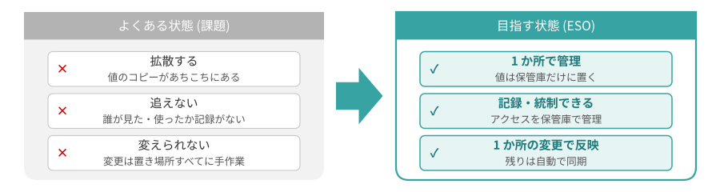

### 1.1 Secret を変更するユースケース

変更は頻繁ではないが、発生したときは作業量が大きく、かつ急ぐ場合が多い。代表例は次のとおり。

| ユースケース | 説明 |
|---|---|
| 証明書の更新 | 証明書には必ず有効期限がある。期限切れはアプリの停止に直結するため、逃げられない変更である |
| 定期ローテーション | DB パスワードや API キーを、社内規程や監査の要求で定期的に交換する。外部サービス側がトークンやクライアントシークレットに有効期限を設定している場合も含む |
| 接続先・発行元の変更 | DB の移行、利用サービスの再契約・キーの再発行などで、値そのものが新しくなる |
| 漏えいの疑い | Git への誤登録、メールやチャットでの誤送信、画面共有での映り込みなどが発生した時点で、その値を直ちに無効化し、全環境で差し替える必要がある |

従来方式では、変更 1 回の作業は「値を置いてある場所の数」に比例する。本方式 (ESO) では、保管庫の 1 か所を変更すれば、残りは自動同期に任せられる (アプリへの反映方法による注意点は 6.4)。**変更の頻度ではなく、変更 1 回あたりの作業とミスの出方が変わる** ことが、本方式の効果の中心である。

### 1.2 この仕組みで誰がどう嬉しいか

| 対象 | 嬉しい点 |
|---|---|
| アプリチーム | 値の実物を知らなくてよい。値の受け渡し待ちや、環境ごとの差し替え作業がなくなり、「自分が漏らしたのではないか」という責任からも解放される |
| プラットフォームチーム | 最初に仕組み (型) を作る手間はかかるが、その後は値の配布や変更の依頼に毎回手作業で応じなくてよくなる |
| 管理・セキュリティ担当 | 誰がどの値にアクセスできるかを保管庫側で一覧・統制できる |
| 運用・障害対応 | 緊急時に変更する場所が 1 か所で、影響範囲が分かる |

なお、小規模・検証目的で、アプリや環境が少なく、担当も固定されている間は、標準 Secret でも実用上困らない場合がある。本方式が効いてくるのは、アプリや環境が増える、担当が替わる、監査や規程の要求が入る、といった変化が起きたときであり、そのときに慌てて導入すると、拡散した値の棚卸しから始めることになる。今のうちに型を作っておくことがポイントである。

## 2. OpenShift での Secret 管理の方法

| 方法 | 概要 | 値の保管先 |
|---|---|---|
| ① 標準 Secret (手動作成) | `oc create secret` で直接登録。簡単だが保管と更新は人手 | クラスタ内 |
| ② **External Secrets Operator (ESO)** | 外部の保管庫の値を、Operator が定期的に Secret へ同期する | **外部の保管庫** |

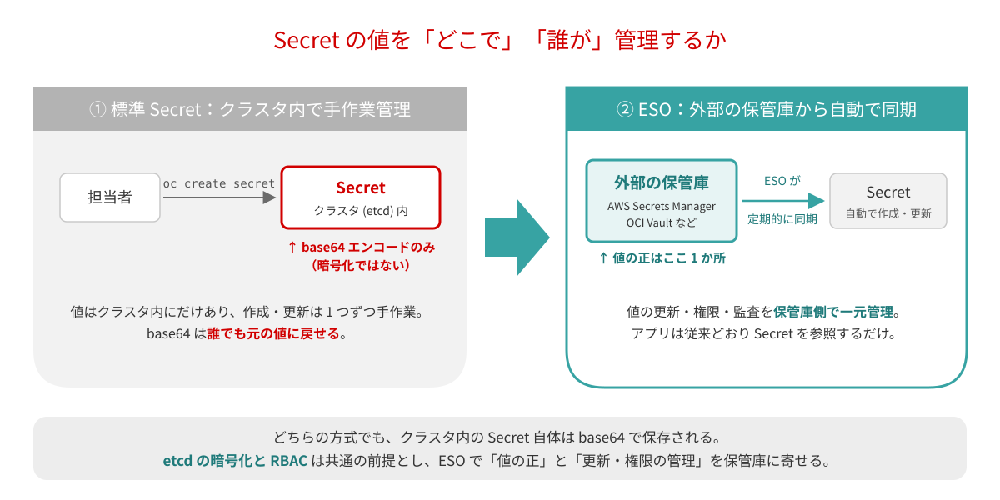

## 3. ESO の仕組み

「どこへ・どう接続するか」(SecretStore) と「何を取得するか」(ExternalSecret) を別のリソースに分けて定義する。

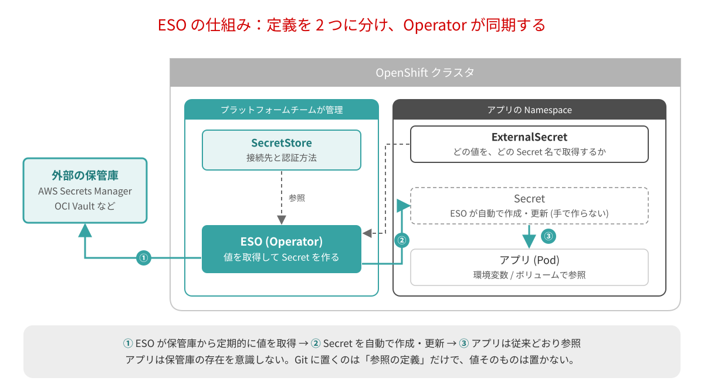

| リソース | スコープ | 役割 | 作る人 |
|---|---|---|---|
| SecretStore | Namespace | 保管庫への接続先と認証方法 (同じ Namespace の ExternalSecret だけが使える) | プラットフォームチーム |
| ClusterSecretStore | クラスタ | SecretStore のクラスタ共通版 (複数の Namespace から使える) | プラットフォームチーム |
| ExternalSecret | Namespace | どの値を、どの名前の Secret にするか | アプリチーム |
| Secret | Namespace | ESO が ExternalSecret と同じ Namespace に自動で作成・更新する (**手で作らない**) | (自動) |

- 図の ① ESO が保管庫から定期的に値を取得し、② Secret を作成・更新する。③ アプリはその Secret を参照する。
- 保管庫側で値を更新すれば、`refreshInterval` (同期間隔) ごとの再取得で自動的に Secret へ反映される。**ただし自動で更新されるのは Secret までであり、アプリへの反映は参照方法による** (環境変数で参照している場合は Pod の再起動が必要、ボリュームで参照している場合は自動で反映される。詳細は 6.4)。
- アプリは OpenShift 標準の Secret を環境変数 / ボリュームで参照する、**一般的なコンテナアプリと同じ作り方**でよい。ESO 専用の SDK やコードは不要で、アプリは保管庫の存在を意識しない。
- Git に置くのは「参照の定義」だけで、値そのものは置かない。

OpenShift 上の全リソースの一覧は 5.4。

> **注:** 同期間隔 (`refreshInterval`) は、時間の文字列 (`30s`、`15m`、`1h` など) で指定する。最小値・最大値の規定はなく、`0` を指定すると最初の 1 回だけ取得する。既定値は `1h` で、Red Hat ドキュメントの例も `1h`。既定の `1h` を基本とし、ローテーションの反映を急ぐ Secret だけ短くする。

## 4. 方式の比較 (メリット・デメリット)

| 観点 | ① 標準 Secret | ② ESO |
|---|---|---|
| 値の保管先 | クラスタ内 | **外部の保管庫** |
| 更新・ローテーション | 手動 | **自動 (定期同期)** |
| Git に値を置かない | ○ (ただし手作業) | **○** |
| 権限・監査の一元管理 | × | **○ (保管庫側)** |
| 保管庫停止時 | 影響なし | 同期済みの Secret で稼働を継続<br>(停止中は更新・新規作成が反映されない) |
| クラスタ (etcd) に値が残る | 残る | 残る |
| 導入の手間 | 小 | 中 (Operator の導入と保管庫の準備) |

> 注: etcd に値が残る点は、etcd の暗号化と RBAC で担保する。
> 注: 「自動 (定期同期)」について詳細は 6.4 を参照。

## 5. 導入手順 (実機検証済みの流れ)

詳細手順とエビデンスは下記リポジトリの docs を参照。

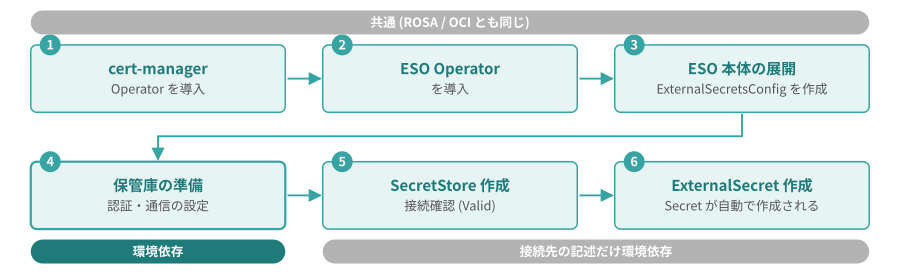

| 手順 | 共通 / 環境依存 |
|---|---|
| 1〜3 Operator と ESO 本体 | 共通 (ROSA / OCI とも同じ) |
| 4 保管庫の準備と認証・通信の設定 | **環境依存** (下表)。ROSA は ESO の外向き通信を許可する NetworkPolicy の追加が必要 |
| 5〜6 SecretStore / ExternalSecret | 接続先の記述だけ環境依存 |

### 5.1 ROSA 版 (保管庫: AWS Secrets Manager)


| 項目 | 内容 |
|---|---|
| 認証 | ROSA の STS (OIDC)。短期トークンで IAM Role を引き受ける。**アクセスキーをクラスタに置かない** |
| AWS 側の準備 | Secrets Manager にシークレット作成、IAM Role と読み取りポリシー、Role の信頼ポリシー |
| OpenShift 側の準備 | ESO の外向き通信 (HTTPS) を許可する NetworkPolicy を `external-secrets` Namespace に追加する。Operator が作る NetworkPolicy (`eso-sys-*`) が外向き通信を止めており、追加しないと SecretStore が通信タイムアウトで Invalid になる |
| 注意点 | Role の信頼ポリシーの namespace / ServiceAccount 名が、クラスタ上の実際の名前と**完全一致**していること |
| 検証結果 | 同期 ✔ ([eso-rosa-verification.md](docs/eso-rosa-verification.md)) |

### 5.2 OCI 版 (保管庫: OCI Vault / OpenShift on OCI)
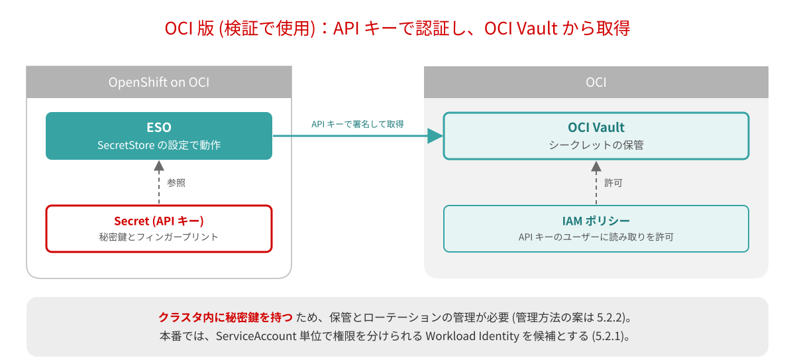

図の ① OCI のユーザー設定で API キーを作成して秘密鍵を作業端末にダウンロードし、② OpenShift に Secret として作成する。③ ESO はその API キーで署名して OCI Vault から値を取得する。

| 項目 | 内容 |
|---|---|
| 認証 | User Principal (API キー)。OCI のユーザー設定で API キーを作成して秘密鍵をダウンロードし、OpenShift に Secret として作成して SecretStore から参照する (検証用) |
| OCI 側の準備 | Vault と Master Encryption Key、シークレット、ユーザー/グループ/IAM ポリシー |
| OpenShift 側の準備 | API キーを入れる Secret の作成。ROSA で必要だった外向き通信の NetworkPolicy は、OCI の検証では追加しなくても接続できた (ESO が外に出られない場合は ROSA と同じ対処をする) |
| 注意点 | API キーの保管とローテーションが必要 (管理案は 5.2.2)。Workload Identity による認証も確認中 (5.2.1) |
| 検証結果 | 同期 ✔、更新追従 ✔ (`refreshInterval` 1 分後に反映) ([eso-oci-vault-verification.md](docs/eso-oci-vault-verification.md)) |

#### 5.2.1 Workload Identity による認証 (確認中)
OpenShift の ServiceAccount (SA) のトークンを OCI の短期トークンに交換して認証する方式。AWS の STS (ROSA) と同じ考え方で、**SA 単位で権限を分けられる**。2026 年 9 月に OCI が自己管理 Kubernetes 向けの対応を発表した。ただし、ESO の OCI 用の Workload 設定は OKE 向けの仕組みを前提にしているため、OpenShift 上の ESO から利用できるかを確認している。

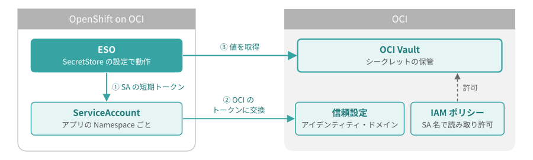

#### 5.2.2 API キー方式で運用する場合の管理案

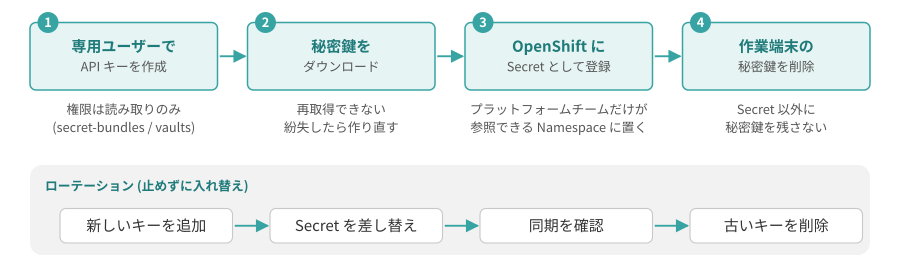

- API キーは、個人ではなく ESO 専用の OCI ユーザーで作成し、環境 (開発 / テスト / 本番) ごとに分ける。
- Secret は ClusterSecretStore から参照し、アプリの Namespace には置かない (アプリの Namespace の管理者が鍵を取り出せるため)。
- IAM ポリシーに通信元の条件 (ネットワーク・ソース) を付け、クラスタの出口 IP からしか使えないようにする。
- フィンガープリントは公開鍵の識別子で、秘密情報ではない。

#### 5.2.3 推奨ロードマップ (現時点の考え)

OCI の認証方式についての、現時点での考え方は次のとおり。**前提として、まず Workload Identity の検証を行い、その結果を報告・ご相談した上で、本番の認証方式を決定する。** 以下の段階は、その決定と、その後の進め方の案である。段階 1 の API キー方式は、検証済みの選択肢として示すものであり、採用を先に確定させるものではない。検証の結果、鍵を持たない方式が使えることが確認できれば、そちらへ寄せていく。

| 段階 | 内容 | 状況・条件 |
|---|---|---|
| 段階 1: API キー方式で開始 | 検証済みの API キー方式で運用を始める。ただし 5.2.2 の管理案 (ESO 専用ユーザー、環境ごとの分離、Secret は ClusterSecretStore から参照してアプリの Namespace に置かない、通信元の条件) を前提条件とする | 実施可能 (検証済み) |
| 段階 2: Workload Identity の確認 | OpenShift 上の ESO で Workload Identity が使えるかを確認する。あわせて、クラスタの見分け方 (発行者の分け方)、署名鍵の変更への追従、トークン交換用資格情報の保管を確認する | 確認中 (5.2.1) |
| 段階 3: Workload Identity へ移行 | 段階 2 の確認が取れた時点で、移行の条件と時期を決める。移行は主に SecretStore 側の認証方法の差し替えであり、アプリ側の ExternalSecret とアプリ自体は原則変更不要とする | 段階 2 の結果による |
| (代替) | Workload Identity が利用できない場合は、API キー方式を正式な運用として確定させる。Instance Principal (ノードの ID で認証する方式) は、権限がノード単位になるため、第一候補にはしない | 段階 2 の結果による |

なお ROSA (AWS) については、クラスタに鍵を置かない STS 方式で検証済みであり、このロードマップは不要である。

### 5.3 環境による違い (要点)
| 観点 | ROSA + AWS (STS) | OCI + API キー (検証で使用) |
|---|---|---|
| クラスタに置く鍵 | なし | あり (秘密鍵) |
| 権限の単位 | Namespace / ServiceAccount | API キーのユーザー |
| 追加の準備 (クラウド側) | IAM Role と信頼設定 | ユーザー / グループ / IAM ポリシー、API キー |
| 追加の準備 (OpenShift 側) | ServiceAccount、外向き通信の NetworkPolicy | API キーの Secret |
| 検証状況 | 検証済み | 検証済み |
| Red Hat の動作確認対象 | 対象 (バージョン別に確認) | 一覧に含まれない (本検証で動作は確認済み) |

### 5.4 OpenShift 上で作成するリソースとスコープ

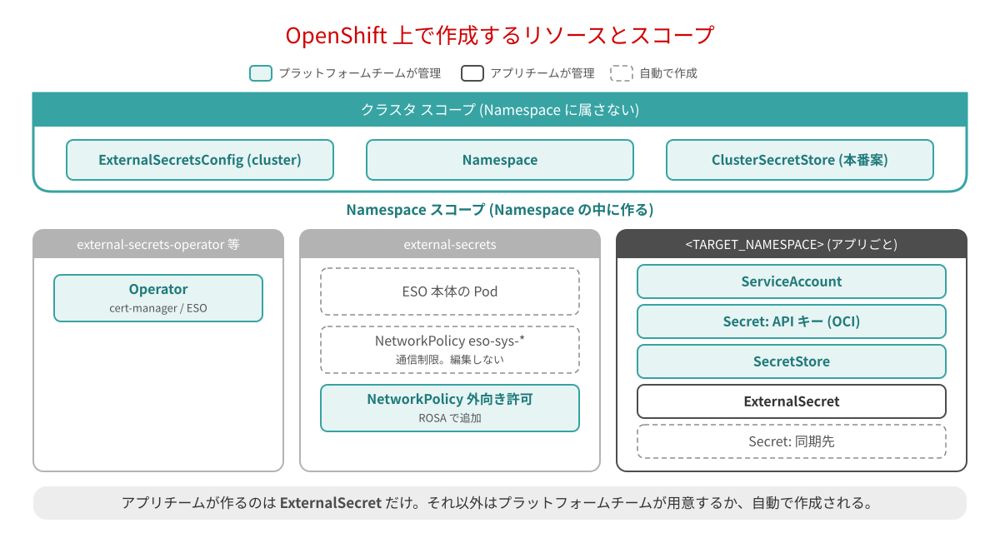

`<TARGET_NAMESPACE>` などのプレースホルダは [yaml/README.md](yaml/README.md) を参照。

## 6. 役割分担と運用設計 (案)

次の 2 チームで考える。

- **プラットフォームチーム**: クラスタの運用・CI/CD 基盤・クラウド (AWS / OCI) の管理を担う
- **アプリチーム**: アプリケーションの開発・運用を担う

**前提:** 現状、AWS Management Console / OCI の Web コンソールを操作する権限を持つのはプラットフォームチームのみ。

### 6.1 作業ごとの担当

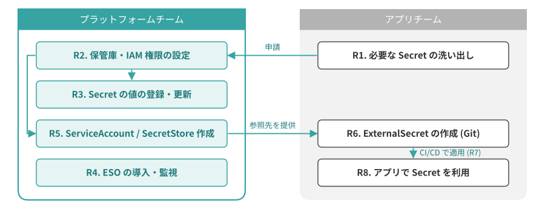

| 項番 | 作業 | プラットフォーム | アプリ |
|---|---|---|---|
| R1 | 必要な Secret の洗い出し (名前・用途・更新頻度) | 確認 | **実施** |
| R2 | 保管庫 (Vault・暗号化キー) の作成、IAM (信頼設定・ポリシー) の設定 (コンソール操作) | **実施** | |
| R3 | Secret の値の登録・更新 (ローテーション含む) | **実施** | 依頼 |
| R4 | ESO / Operator の導入・更新・監視 | **実施** | |
| R5 | アプリごとの ServiceAccount と SecretStore の作成 | **実施** | |
| R6 | ExternalSecret の作成 (Git 管理) | | **実施** |
| R7 | manifest のデプロイ自動化 (CI/CD) | **実施** | 利用 |
| R8 | アプリでの Secret の利用 | | **実施** |

### 6.2 Secret の値の受け渡し方法
以下のような案が考えられるが、要検討。

| 案 | 内容 | 評価 |
|---|---|---|
| A. アプリチームが保管庫に直接登録 | アプリチームに保管庫への登録権限を付与する | 受け渡しそのものが不要になる。コンソール権限の付与と、アプリ間の権限の分け方 (6.3) の決定が前提 |
| B. 開発環境から先に A を適用 | 開発環境はアプリチームが登録し、テスト・本番はプラットフォームチームが登録する | 段階的に移行できる |
| C. 既存の社内の仕組みを使う | パスワード管理ツール、アクセス制限付きのファイル共有 (パスワードは別経路) など | 社内で使えるものの棚卸しが必要 |

### 6.3 権限の設計 (OCI + Workload Identity の案)

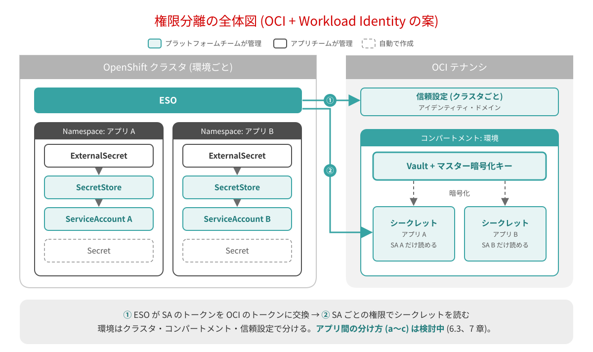

図の ① ESO が ServiceAccount のトークンを OCI のトークンに交換し、② ServiceAccount ごとの権限でシークレットを読む。開発・テスト・本番の各環境 (クラスタは環境ごとに分ける) を対象とする。

**OCI のリソースの関係と単位**

| リソース | 役割 | 単位・制約 | 設計案 |
|---|---|---|---|
| コンパートメント | リソースを入れるフォルダ。権限はこの単位で付けるのが基本 | 階層を作れる | 環境ごと (開発 / テスト / 本番) |
| Vault | 暗号化キーを入れる入れ物 | 1 つのコンパートメントに属する。同じコンパートメントに複数作れる | 環境ごとに 1 つ (アプリ間の分け方によっては複数。下表) |
| マスター暗号化キー | シークレットを暗号化する鍵 | 1 つの Vault の中に作る。1 つのキーで複数のシークレットを暗号化できる | Vault ごとに 1 つ |
| シークレット | 値そのもの | 作成時に「置くコンパートメント」「Vault」「キー」を選ぶ | 環境のコンパートメントに置く |

**IAM ポリシーとは**

「誰が・何に・何をしてよいか」を書いた許可の文。ポリシーはコンパートメント (またはテナンシ) に置き、その場所と下の階層に効く。

```
Allow <誰が> to <何をする> <何に> in compartment <どこで> where <条件>
```

| 要素 | 本設計で使うもの |
|---|---|
| 誰が | `group` (人のグループ) / `any-user` + 条件 (Workload Identity の ServiceAccount を条件で指定) |
| 何をする | `read` (読み取り) / `use` (利用) / `manage` (作成・変更・削除) |
| 何に | `secret-bundles` (シークレットの値) / `secret-family` (シークレット一式) / `vaults` / `keys` |

本設計のポリシー (本番の例。他の環境も同じ形):

| 対象 | ポリシー |
|---|---|
| ESO (アプリの ServiceAccount) | `Allow any-user to read secret-bundles in compartment prod where all { request.principal.type = 'identityfederateddomainapp', request.principal.name = 'system:serviceaccount:<Namespace>:<ServiceAccount>', request.principal.ext_iss = '<本番クラスタの発行者>' }` と、同じ条件で `read vaults` (ESO が SecretStore の接続確認で Vault の情報を読むため)。アプリ間で分ける場合は下表の条件を追加する |
| プラットフォームチーム | `Allow group platform-admins to manage vaults / keys / secret-family in compartment prod` (3 行) |

**アプリ間の分け方 (候補)**

| 案 | 内容 | 留意点 |
|---|---|---|
| a. シークレット名で分ける | ポリシーの条件にシークレット名 (`target.secret.name`) を加え、アプリごとに読めるシークレットを限定する | 命名規則が前提。条件の書き方は確認が必要 |
| b. Vault をアプリごとに分ける | 同じコンパートメントにアプリごとの Vault を作り、条件で Vault (`target.vault.id`) を限定する | Vault とキーの数が増える。条件として使えるかは確認が必要 |
| c. 分けない | 環境単位でのみ分ける。アプリ間は OpenShift 側 (SecretStore の作成権限) で担保する | 構成は最も簡単。IAM ではアプリを区別しない |

**境界ごとの分け方**

| 境界 | 分ける単位 | 担保する仕組み |
|---|---|---|
| 環境 (開発 / テスト / 本番) | クラスタ、環境のコンパートメント、Vault | クラスタごとの信頼設定と、IAM ポリシーの発行者 (`ext_iss`) の条件 |
| アプリ | Namespace、ServiceAccount | IAM ポリシーの ServiceAccount 名の条件と、上表の a〜c のいずれか |
| クラスタ内の操作 | Namespace | OpenShift の RBAC (アプリチームは自分の Namespace の中だけ操作できる) |
| 保管庫・暗号化キーの管理 | 環境のコンパートメント | IAM グループとポリシー (プラットフォームチームのみ) |

### 6.4 運用フロー (案)

**新しい Secret を追加する**

| 順 | 作業 | 担当 | 項番 |
|---|---|---|---|
| 1 | 必要な Secret (名前・用途・更新頻度) を申請 | アプリ | R1 |
| 2 | アプリを初めて載せる場合のみ: IAM ポリシー、ServiceAccount、SecretStore を各環境に用意 | プラットフォーム | R2、R5 |
| 3 | 開発 → テスト → 本番の順に値を登録 (受け渡しは 6.2) | プラットフォーム | R3 |
| 4 | ExternalSecret を Git に登録 | アプリ | R6 |
| 5 | デプロイし、Secret が作成されたことを確認 | CI/CD → アプリ | R7、R8 |

**値を更新する (ローテーション)**

| 順 | 作業 | 担当 |
|---|---|---|
| 1 | 保管庫に新しいバージョンを登録 | プラットフォーム |
| 2 | `refreshInterval` 後に Secret へ自動反映 (3 章)。これだけではアプリの動作は変わらない場合がある (次の行) | (自動) |
| 3 | アプリへの反映: 環境変数で参照している場合は Pod の再起動が必要。ボリュームで参照している場合は自動で反映される | アプリ |

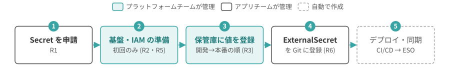

## 付録: 参照ドキュメント
- [eso-rosa-verification.md](docs/eso-rosa-verification.md) — ROSA 版の手順
- [eso-oci-vault-verification.md](docs/eso-oci-vault-verification.md) — OCI 版の手順と検証結果
- [External Secrets Operator for Red Hat OpenShift (OCP 4.20)](https://docs.redhat.com/en/documentation/openshift_container_platform/4.20/html/security_and_compliance/external-secrets-operator-for-red-hat-openshift) — Red Hat 公式。動作確認済みの保管庫の一覧
- [ExternalSecret API (external-secrets.io)](https://external-secrets.io/latest/api/externalsecret/) — `refreshInterval` と `refreshPolicy` の仕様
- [Oracle Vault provider (external-secrets.io)](https://external-secrets.io/latest/provider/oracle-vault/) — OCI の認証方式 (User / Instance Principal / Workload Identity)
- [Workload Identity for Self-Managed Kubernetes (Oracle ブログ)](https://blogs.oracle.com/cloud-infrastructure/workload-identity-for-self-managed-k8s) — OCI の自己管理 Kubernetes 向け Workload Identity
- [Vault の IAM ポリシー リファレンス (OCI)](https://docs.oracle.com/en-us/iaas/Content/Identity/Reference/keypolicyreference.htm) — `secret-bundles` などのリソース種別と条件
