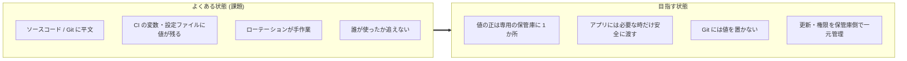
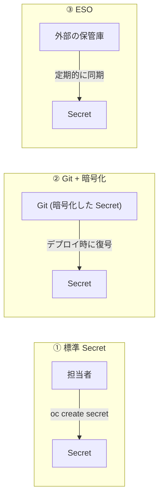
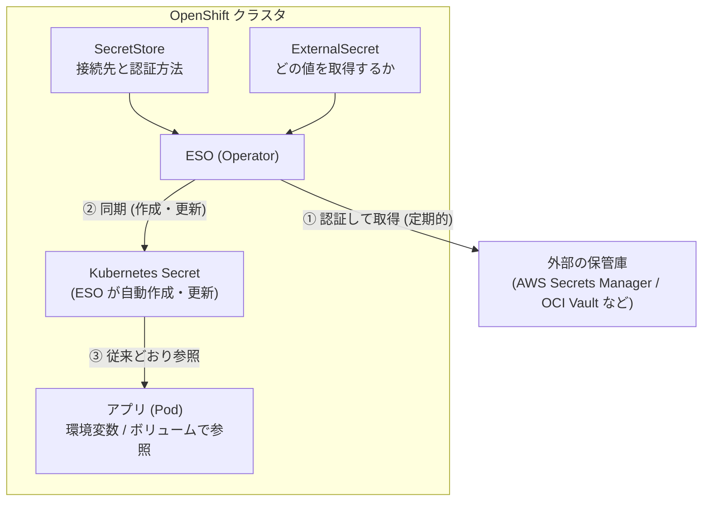
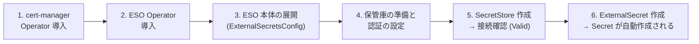
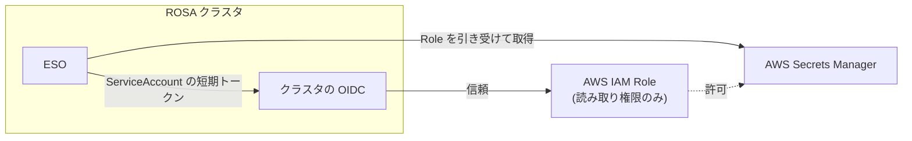
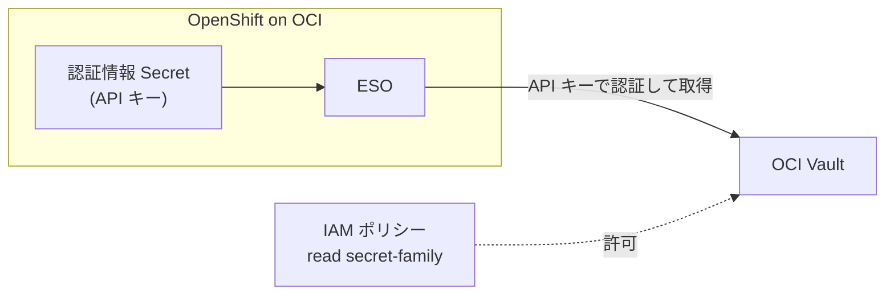
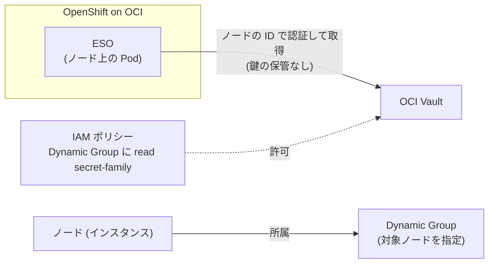
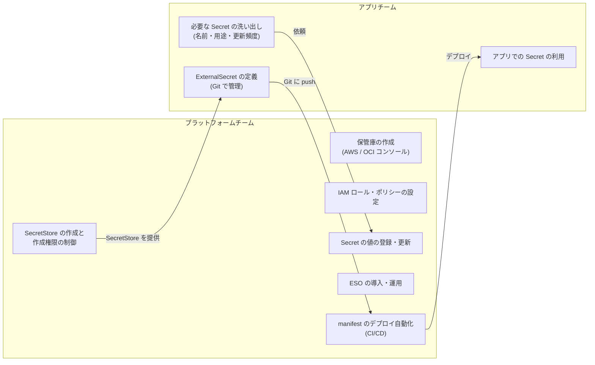
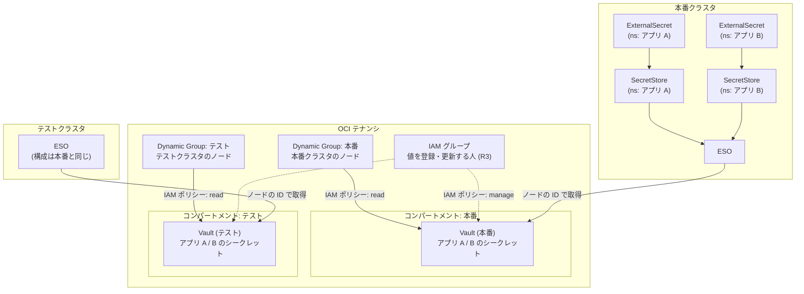

# OpenShift における Secret 管理と External Secrets Operator (ESO) のご提案

> 検証結果は ROSA (AWS Secrets Manager) / OpenShift on OCI (OCI Vault) の実機検証に基づく。
> 図は Mermaid 形式 (GitHub 上で図として表示される)。

## 1. Secret とは、なぜ管理が必要か

**Secret** = パスワード、API キー、証明書、トークンなど、漏えいすると被害が出る値。

## 2. OpenShift / Kubernetes での Secret 管理の方法

| 方法 | 概要 | 値の保管先 |
|---|---|---|
| ① 標準 Secret (手動作成) | `oc create secret` で直接登録。簡単だが保管と更新は人手 | クラスタ内 |
| ② Git で管理 (暗号化) | SealedSecrets / SOPS などで暗号化した Secret を Git に置く (GitOps 向け) | Git (暗号化) |
| ③ **External Secrets Operator (ESO)** | 外部の保管庫の値を、Operator が定期的に Kubernetes の Secret へ同期する | **外部の保管庫** |

## 3. ESO の仕組み

「どこへ・どう接続するか」(SecretStore) と「何を取得するか」(ExternalSecret) を別のリソースに分けて定義する。

| リソース | 役割 | 作る人 |
|---|---|---|
| SecretStore | 保管庫への接続先と認証方法 | プラットフォームチーム |
| ExternalSecret | どの値を、どの名前の Secret にするか | アプリチーム |
| Kubernetes Secret | ESO が自動で作成・更新する (**手で作らない**) | (自動) |

- 保管庫側で値を更新すれば、`refreshInterval` ごとの再取得で自動的に Secret へ反映される (検証では 1 分周期)。
- アプリは Kubernetes 標準の Secret を環境変数 / ボリュームで参照する、**一般的なコンテナアプリと同じ作り方**でよい。ESO 専用の SDK やコードは不要で、アプリは保管庫の存在を意識しない。
- Git に置くのは「参照の定義」だけで、値そのものは置かない。

### 3.1 同期間隔 (`refreshInterval`) の考え方

| 項目 | 内容 |
|---|---|
| 指定できる値 | 時間の文字列 (`30s`、`15m`、`1h` など)。最小値・最大値の規定はない |
| `0` を指定した場合 | 最初の 1 回だけ取得し、以降は更新しない |
| 既定値 | CRD の既定は `1h`。Red Hat ドキュメントの例も `1h` |
| 短くしすぎた場合の負荷 | ① 保管庫の API 呼び出し (従量課金・API 制限の対象)、② ESO の Pod (CPU・通信)、③ OpenShift の API サーバー / etcd (同期のたびに ExternalSecret のステータスを書き込む) |
| 目安 | 既定の `1h` を基本とし、ローテーションの反映を急ぐ Secret だけ短くする。分未満の間隔は避ける |

> 負荷の例: ExternalSecret 100 個を 1 分間隔で同期すると、保管庫への呼び出しは月に約 430 万回になる (AWS Secrets Manager の場合、API 料金だけで月 20 ドル強)。

## 4. 方式の比較 (メリット・デメリット)

| 観点 | ① 標準 Secret | ② Git + 暗号化 | ③ ESO |
|---|---|---|---|
| 値の保管先 | クラスタ内 | Git (暗号化) | **外部の保管庫** |
| 更新・ローテーション | 手動 | 再暗号化・再配布 | **自動 (定期同期)** |
| Git に値を置かない | ○ (ただし手作業) | △ (暗号化して置く) | **○** |
| 権限・監査の一元管理 | × | △ | **○ (保管庫側)** |
| 保管庫停止時 | 影響なし | 影響なし | 同期済みの Secret で稼働継続 |
| クラスタ (etcd) に値が残る | 残る | 残る | 残る |
| 導入の手間 | 小 | 中 | 中 (Operator 導入と保管庫の準備) |
| 追加の費用 | なし | なし | 保管庫の利用料 (下表) |
| 向く場面 | 小規模・検証 | GitOps を徹底したい | **標準の選択肢 (本提案)** |

**ESO のデメリット/留意点**
- クラスタ内 (etcd) に Secret が残る → etcd の暗号化と RBAC で担保する。
- ESO は強い権限で動くため、SecretStore を作れる人を絞る。
- 保管庫の準備 (作成・権限設定) が別途必要。利用料は保管庫によって異なる。

**保管庫の利用料 (2026 年 11 月時点。最新は各社の価格表で確認)**

| 保管庫 | 課金の対象 | 備考 |
|---|---|---|
| OCI Vault (Secret Management) | **シークレットは無料**。暗号化キーは、ソフトウェア保護キーは無料、HSM 保護キーは 20 キー・バージョンまで無料で以降はキー・バージョン単位の月額 | Private Vault (専有型) を選ぶと Vault 単位の時間課金が加わる。通常の Virtual Vault なら追加費用は小さい |
| AWS Secrets Manager | シークレット 1 個あたり月額 (0.40 USD) + API 呼び出し 1 万回あたり 0.05 USD | `refreshInterval` を短くするほど API 料金が増える |

## 5. 導入手順 (実機検証済みの流れ)

詳細手順とエビデンスは下記リポジトリの docs を参照。

| 手順 | 共通 / 環境依存 |
|---|---|
| 1〜3 Operator と ESO 本体 | 共通 (ROSA / OCI とも同じ) |
| 4 保管庫の準備と認証 | **環境依存** (下表) |
| 5〜6 SecretStore / ExternalSecret | 接続先の記述だけ環境依存 |

### 5.1 ROSA 版 (保管庫: AWS Secrets Manager)

| 項目 | 内容 |
|---|---|
| 認証 | ROSA の STS (OIDC)。短期トークンで IAM Role を引き受ける。**アクセスキーをクラスタに置かない** |
| AWS 側の準備 | Secrets Manager にシークレット作成、IAM Role と読み取りポリシー、Role の信頼ポリシー |
| 注意点 | Role の信頼ポリシーの namespace / ServiceAccount 名が、クラスタ上の実際の名前と**完全一致**していること |
| 検証結果 | 同期 ✔ ([eso-rosa-verification.md](docs/eso-rosa-verification.md)) |

### 5.2 OCI 版 (保管庫: OCI Vault / OpenShift on OCI)

| 項目 | 内容 |
|---|---|
| 認証 | User Principal (API キー)。キーを K8s Secret に保管して SecretStore から参照 (検証用) |
| OCI 側の準備 | Vault と Master Encryption Key、シークレット、ユーザー/グループ/IAM ポリシー |
| 注意点 | API キーの保管とローテーションが必要。本番では Instance Principal を検討 (5.2.1)。**OCI Vault は Red Hat のサポート対象外** (技術的な動作確認のみ) |
| 検証結果 | 同期 ✔、更新追従 ✔ (`refreshInterval` 1 分後に反映) ([eso-oci-vault-verification.md](docs/eso-oci-vault-verification.md)) |

#### 5.2.1 本番候補: Instance Principal (未検証)
ノード (OCI のコンピュート・インスタンス) 自身の ID で OCI に認証する方式。クラスタに鍵を置かず、短期の証明書・トークンが自動で発行・更新される。

| 観点 | AWS の STS (ROSA) | OCI の Instance Principal |
|---|---|---|
| 似ている点 | 鍵をクラスタに置かない、短期の認証情報 | 同左 |
| 権限の単位 | **Namespace / ServiceAccount 単位** (信頼ポリシーで指定) | **ノード単位** (Dynamic Group で指定) |
| AWS で例えると | — | STS より、EC2 のインスタンスプロファイルに近い |
| 留意点 | — | 同じノード上の他の Pod も同じ権限を使える可能性がある。対象ノードの限定とメタデータ (169.254.169.254) への通信制御を要検討 |

> STS と同じく ServiceAccount 単位で権限を分けられる方式として、OCI には Workload Identity がある。ESO のドキュメントでは OKE 向けとして記載されている。OCI は 2026 年 9 月に自己管理 Kubernetes 向けにも対応を発表したが、OpenShift on OCI と ESO で使えるかは未確認。

### 5.3 環境による違い (要点)
| 観点 | ROSA + AWS (STS) | OCI + API キー (検証で使用) | OCI + Instance Principal (本番候補) |
|---|---|---|---|
| クラスタに置く鍵 | なし | あり (秘密鍵) | なし |
| 権限の単位 | Namespace / ServiceAccount | API キーのユーザー | ノード (Dynamic Group) |
| 追加の準備 | IAM Role と信頼設定 | ユーザー / グループ / IAM ポリシー、API キー | Dynamic Group、IAM ポリシー |
| 検証状況 | 検証済み | 検証済み | 未検証 |
| Red Hat のサポート | ESO の対象 (バージョン別に要確認) | **対象外** | **対象外** |

## 6. 役割分担 (案)

次の 2 チームで考える。

- **プラットフォームチーム**: クラスタの運用・CI/CD 基盤・クラウド (AWS / OCI) の管理を担う
- **アプリチーム**: アプリケーションの開発・運用を担う

**前提:** 現状、AWS Management Console / OCI の Web コンソールを操作する権限を持つのはプラットフォームチームのみ。将来はアプリチームにも一部の操作権限を渡す可能性がある。

### 6.1 全体像 (現状の案)

### 6.2 作業ごとの担当 (現状)

| 項番 | 作業 | プラットフォーム | アプリ |
|---|---|---|---|
| R1 | 必要な Secret の洗い出し (名前・用途・更新頻度) | 確認 | **実施** |
| R2 | 保管庫の作成、IAM (Role / Dynamic Group / ポリシー) の設定 (コンソール操作) | **実施** | |
| R3 | Secret の値の登録・更新 (ローテーション含む) | **実施** | 依頼 |
| R4 | ESO / Operator の導入・更新・監視 | **実施** | |
| R5 | SecretStore の作成と、作成できる人の制御 (RBAC) | **実施** | |
| R6 | ExternalSecret の作成 (Git 管理) | — (※) | **実施** |
| R7 | manifest のデプロイ自動化 (CI/CD) | **実施** | 利用 |
| R8 | アプリでの Secret の利用 | | **実施** |

※ ExternalSecret は Namespace 単位のリソースのため、アプリチームがプラットフォームチームを介さずに作成できる。プラットフォームチームは 1 件ずつ確認するのではなく、**R5 で「どの保管庫を参照できるか」の枠をあらかじめ決めておく** (SecretStore の作成権限を絞る、参照先の SecretStore を Namespace ごとに限定する) ことで統制する。

### 6.3 将来の案: アプリチームにも権限を渡す場合
アプリチームがコンソールを操作できるようになったら、**自分のアプリ分の Secret に限って**値の登録・更新を行えるようにする (例: 保管庫のパス/コンパートメントをアプリごとに分け、その範囲だけ権限を付与)。

| 項番 (6.2) | 作業 | 現状 | 将来 |
|---|---|---|---|
| R3 | Secret の値の登録・更新 | プラットフォーム | **アプリ (自分の範囲のみ)** |
| R2 | 保管庫の作成、IAM の設定 | プラットフォーム | プラットフォーム (変更なし) |
| R5 | SecretStore の作成と作成権限の制御 | プラットフォーム | プラットフォーム (変更なし) |
| R1、R4、R6〜R8 | — | 変更なし | 変更なし |

### 6.4 相談したい論点
- Secret の値の受け渡し方法 (アプリチームから値を安全にプラットフォームへ渡す手段。チャットやメールに平文で書かない)
- SecretStore を Namespace (アプリ) ごとに分けるか、共通にするか → 最小権限を重視するなら分ける
- 環境 (開発/検証/本番) ごとの保管庫と権限の分け方
- アプリチームへの権限委譲の範囲とタイミング

#### 6.4.1 リソースの管理単位 (OCI 本番運用のたたき台)
クラスタは本番用とテスト用に分ける前提で、OCI 側と OpenShift 側のリソースの対応を示す。

| 分けたい単位 | 分け方 | Instance Principal での実現性 |
|---|---|---|
| 環境 (本番 / テスト) | クラスタを分け、コンパートメントと Vault も分ける。Dynamic Group をクラスタごとに作り、自分の環境の Vault だけ読めるようにする | ○ OCI の IAM で分離できる |
| アプリ (Namespace) | SecretStore を Namespace ごとに作り、参照先を限定する。SecretStore の作成はプラットフォームチームのみ (RBAC) | △ **IAM ではアプリを区別できない** (同じノードの ID で取得するため)。OpenShift の RBAC で担保する |
| 値を登録・更新する人 (R3) | コンパートメント / Vault 単位で IAM グループにポリシーを付与 | ○ 6.3 の将来案もこの単位で実現できる |

**残る課題**
- Dynamic Group の対象: クラスタの全ノードとするか、ESO を置くノード (Infra ノードなど) にタグを付けて絞るか
- 同じノード上の他の Pod が Instance Principal を使えないようにする対策 (メタデータへの通信制御) — 要検証
- アプリ単位まで IAM で分けたい場合の Workload Identity の適用可否 — 要検証
- Vault を環境ごとに 1 つとするか、アプリごとにも分けるか (コンパートメント設計と合わせて決める)

## 7. 導入にあたっての留意点
| 項目 | 内容 |
|---|---|
| サポート範囲 | OCI Vault は Red Hat サポート対象外。AWS Secrets Manager 等はバージョン別に確認 |
| 認証方式 | 検証は簡易な方式。本番は ROSA は STS (標準)、OCI は Instance Principal を基本に検討 (権限の単位は 6.4.1) |
| etcd 上の Secret | ESO は etcd に Secret を残す → etcd 暗号化と RBAC を前提にする |
| 保管庫の可用性 | 同期済み Secret があれば稼働は継続。停止中は更新・新規 Secret が反映されない |
| 権限の設計 | ESO に渡す保管庫の権限は最小限にする |
| 同期間隔 | `refreshInterval` を短くしすぎると、保管庫の API 料金と API サーバーの負荷が増える (3.1) |

## 付録: 参照ドキュメント
- [eso-rosa-verification.md](docs/eso-rosa-verification.md) — ROSA 版の手順
- [eso-oci-vault-verification.md](docs/eso-oci-vault-verification.md) — OCI 版の手順と検証結果
- [External Secrets Operator for Red Hat OpenShift (OCP 4.20)](https://docs.redhat.com/en/documentation/openshift_container_platform/4.20/html/security_and_compliance/external-secrets-operator-for-red-hat-openshift) — Red Hat 公式。動作確認済みの保管庫の一覧 (OCI Vault は含まれない)
- [ExternalSecret API (external-secrets.io)](https://external-secrets.io/latest/api/externalsecret/) — `refreshInterval` と `refreshPolicy` の仕様
- [Oracle Vault provider (external-secrets.io)](https://external-secrets.io/latest/provider/oracle-vault/) — OCI の認証方式 (User / Instance Principal / Workload Identity)
- [Oracle Cloud セキュリティ価格表](https://www.oracle.com/cloud/security/pricing.html) — OCI Vault / Secret Management の料金
