# OpenShift における Secret 管理と External Secrets Operator (ESO) について


## 目次
- [1. Secret とは、なぜ管理が必要か](#1-secret-とはなぜ管理が必要か)
- [2. OpenShift / Kubernetes での Secret 管理の方法](#2-openshift--kubernetes-での-secret-管理の方法)
- [3. ESO の仕組み](#3-eso-の仕組み)
  - [3.1 同期間隔 (refreshInterval) の考え方](#31-同期間隔-refreshinterval-の考え方)
- [4. 方式の比較 (メリット・デメリット)](#4-方式の比較-メリットデメリット)
- [5. 導入手順 (実機検証済みの流れ)](#5-導入手順-実機検証済みの流れ)
  - [5.1 ROSA 版 (保管庫: AWS Secrets Manager)](#51-rosa-版-保管庫-aws-secrets-manager)
  - [5.2 OCI 版 (保管庫: OCI Vault / OpenShift on OCI)](#52-oci-版-保管庫-oci-vault--openshift-on-oci)
  - [5.3 環境による違い (要点)](#53-環境による違い-要点)
  - [5.4 OpenShift 上で作成するリソースとスコープ](#54-openshift-上で作成するリソースとスコープ)
- [6. 役割分担と運用設計 (案)](#6-役割分担と運用設計-案)
  - [6.1 作業ごとの担当](#61-作業ごとの担当)
  - [6.2 Secret の値の受け渡し方法](#62-secret-の値の受け渡し方法)
  - [6.3 権限の設計 (OCI + Workload Identity の案)](#63-権限の設計-oci--workload-identity-の案)
  - [6.4 運用フロー (案)](#64-運用フロー-案)
- [7. 今後の検討事項](#7-今後の検討事項)
- [付録: 参照ドキュメント](#付録-参照ドキュメント)

## 1. Secret とは、なぜ管理が必要か

**Secret** = パスワード、API キー、証明書、トークンなど、漏えいすると被害が出る値。

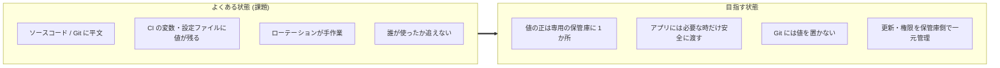

## 2. OpenShift / Kubernetes での Secret 管理の方法

| 方法 | 概要 | 値の保管先 |
|---|---|---|
| ① 標準 Secret (手動作成) | `oc create secret` で直接登録。簡単だが保管と更新は人手 | クラスタ内 |
| ② **External Secrets Operator (ESO)** | 外部の保管庫の値を、Operator が定期的に Kubernetes の Secret へ同期する | **外部の保管庫** |

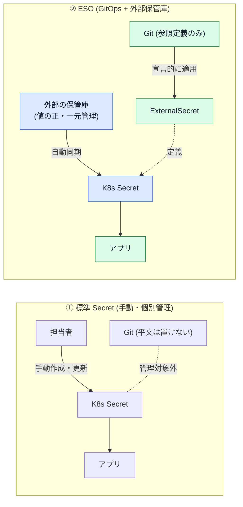

## 3. ESO の仕組み

「どこへ・どう接続するか」(SecretStore) と「何を取得するか」(ExternalSecret) を別のリソースに分けて定義する。

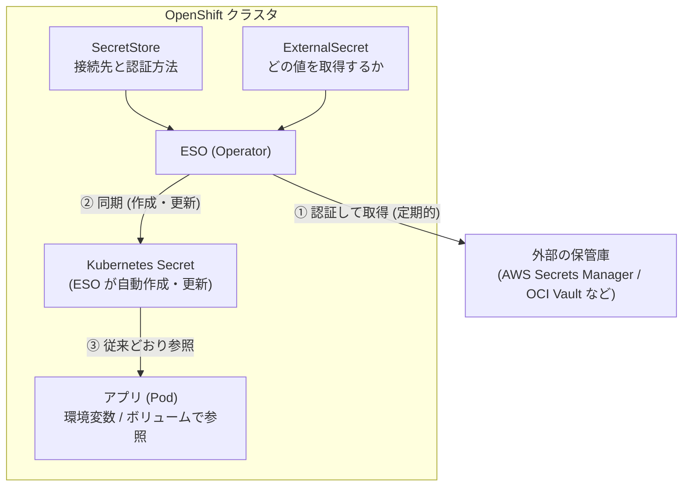

| リソース | スコープ | 役割 | 作る人 |
|---|---|---|---|
| SecretStore | Namespace | 保管庫への接続先と認証方法 (同じ Namespace の ExternalSecret だけが使える) | プラットフォームチーム |
| ClusterSecretStore | クラスタ | SecretStore のクラスタ共通版 (複数の Namespace から使える) | プラットフォームチーム |
| ExternalSecret | Namespace | どの値を、どの名前の Secret にするか | アプリチーム |
| Kubernetes Secret | Namespace | ESO が ExternalSecret と同じ Namespace に自動で作成・更新する (**手で作らない**) | (自動) |

> スコープ: 「クラスタ」は Namespace に属さずクラスタ全体で 1 つの名前空間を持つリソース、「Namespace」は Namespace の中に作るリソース。OpenShift 上の全リソースの一覧は 5.4。

- 保管庫側で値を更新すれば、`refreshInterval` ごとの再取得で自動的に Secret へ反映される (検証では 1 分周期)。
- アプリは Kubernetes 標準の Secret を環境変数 / ボリュームで参照する、**一般的なコンテナアプリと同じ作り方**でよい。ESO 専用の SDK やコードは不要で、アプリは保管庫の存在を意識しない。
- Git に置くのは「参照の定義」だけで、値そのものは置かない。

### 3.1 同期間隔 (`refreshInterval`) の考え方

| 項目 | 内容 |
|---|---|
| 指定できる値 | 時間の文字列 (`30s`、`15m`、`1h` など)。最小値・最大値の規定はない |
| `0` を指定した場合 | 最初の 1 回だけ取得し、以降は更新しない |
| 既定値 | CRD の既定は `1h`。Red Hat ドキュメントの例も `1h` |
| 目安 | 既定の `1h` を基本とし、ローテーションの反映を急ぐ Secret だけ短くする |

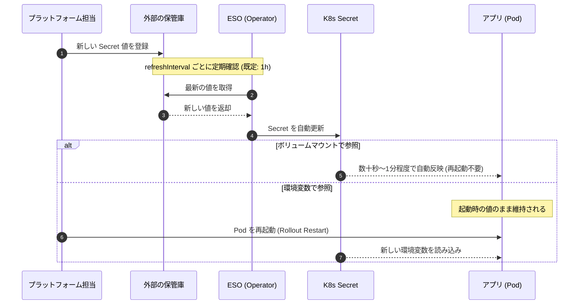

## 4. 方式の比較 (メリット・デメリット)

| 観点 | ① 標準 Secret | ② ESO |
|---|---|---|
| 値の保管先 | クラスタ内 | **外部の保管庫** |
| 更新・ローテーション | 手動 | **自動 (定期同期)** |
| Git に値を置かない | ○ (ただし手作業) | **○** |
| 権限・監査の一元管理 | × | **○ (保管庫側)** |
| 保管庫停止時 | 影響なし | 同期済みの Secret で稼働を継続 (停止中は値の更新・新しい Secret の作成が反映されない) |
| クラスタ (etcd) に値が残る | 残る | 残る |
| 導入の手間 | 小 | 中 (Operator の導入と保管庫の準備) |
| 向く場面 | 小規模・検証 | **標準の選択肢 (本提案)** |

**ESO の留意点**
- etcd に値が残る点は、etcd の暗号化と RBAC で担保する。
- ESO は強い権限で動くため、SecretStore を作れる人を絞る (6 章)。
- 保管庫の準備 (作成・権限設定) が別途必要 (5 章)。
- Red Hat の動作確認対象かどうかは保管庫によって異なる (5.3)。

## 5. 導入手順 (実機検証済みの流れ)

詳細手順とエビデンスは下記リポジトリの docs を参照。

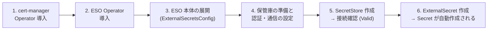

| 手順 | 共通 / 環境依存 |
|---|---|
| 1〜3 Operator と ESO 本体 | 共通 (ROSA / OCI とも同じ) |
| 4 保管庫の準備と認証・通信の設定 | **環境依存** (下表)。ROSA は ESO の外向き通信を許可する NetworkPolicy の追加が必要 |
| 5〜6 SecretStore / ExternalSecret | 接続先の記述だけ環境依存 |

### 5.1 ROSA 版 (保管庫: AWS Secrets Manager)
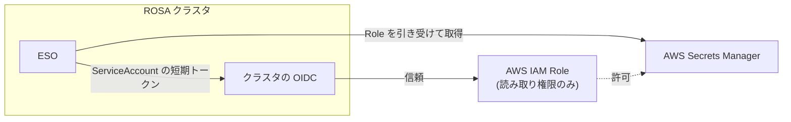
| 項目 | 内容 |
|---|---|
| 認証 | ROSA の STS (OIDC)。短期トークンで IAM Role を引き受ける。**アクセスキーをクラスタに置かない** |
| AWS 側の準備 | Secrets Manager にシークレット作成、IAM Role と読み取りポリシー、Role の信頼ポリシー |
| OpenShift 側の準備 | ESO の外向き通信 (HTTPS) を許可する NetworkPolicy を `external-secrets` Namespace に追加する。Operator が作る NetworkPolicy (`eso-sys-*`) が外向き通信を止めており、追加しないと SecretStore が通信タイムアウトで Invalid になる |
| 注意点 | Role の信頼ポリシーの namespace / ServiceAccount 名が、クラスタ上の実際の名前と**完全一致**していること |
| 検証結果 | 同期 ✔ ([eso-rosa-verification.md](docs/eso-rosa-verification.md)) |

### 5.2 OCI 版 (保管庫: OCI Vault / OpenShift on OCI)
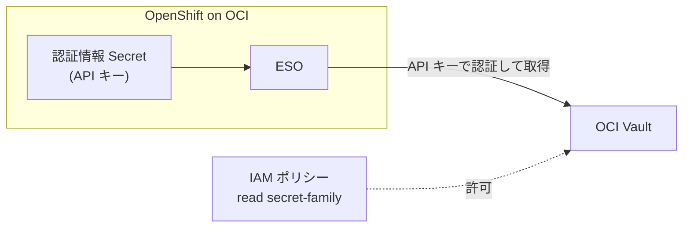
| 項目 | 内容 |
|---|---|
| 認証 | User Principal (API キー)。キーを K8s Secret に保管して SecretStore から参照 (検証用) |
| OCI 側の準備 | Vault と Master Encryption Key、シークレット、ユーザー/グループ/IAM ポリシー |
| OpenShift 側の準備 | API キーを入れる Secret。ROSA で必要だった外向き通信の NetworkPolicy は、OCI の検証では追加しなくても接続できた (ESO が外に出られない場合は ROSA と同じ対処をする) |
| 注意点 | API キーの保管とローテーションが必要 (管理方法の案は 5.2.2)。本番では Workload Identity を検討 (5.2.1) |
| 検証結果 | 同期 ✔、更新追従 ✔ (`refreshInterval` 1 分後に反映) ([eso-oci-vault-verification.md](docs/eso-oci-vault-verification.md)) |

#### 5.2.1 本番候補: Workload Identity (確認中)
OpenShift の ServiceAccount (SA) のトークンを OCI の短期トークンに交換して認証する方式。AWS の STS (ROSA) と同じ考え方で、**SA 単位で権限を分けられる**。2026 年 9 月に OCI が自己管理 Kubernetes 向けの対応を発表した。

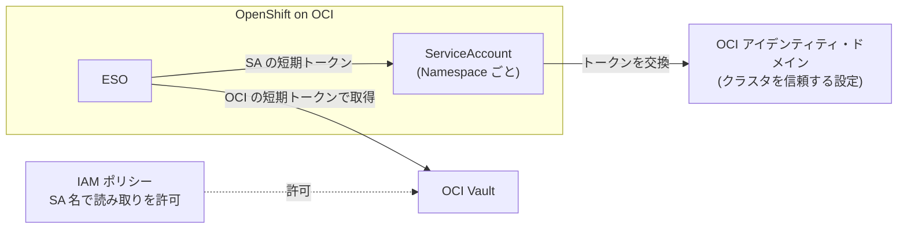

> ESO の OCI 用の Workload 設定は OKE 向けの仕組みを前提にしているため、OpenShift 上の ESO から利用できるかを確認している (7 章 No. 6)。
> Instance Principal (ノード自身の ID で認証する方式) は、権限がノード単位になり同じノード上のすべての Pod に及ぶため第一候補にはしないが、代替案として評価する (7 章 No. 10)。

#### 5.2.2 API キー方式で運用する場合の管理 (案)
Workload Identity の確認結果によっては、当面 API キー方式で運用する可能性がある。その場合の管理方法の案を示す。

**秘密鍵とフィンガープリントの扱い**
- 必要なのはクラスタの Secret の中だけ (etcd に保存)。ノードや作業端末にファイルとして置いておく必要はない。
- 作業端末の秘密鍵 (PEM) は、Secret を作るときに一度使うだけ。作成後は削除する。
- OCI に登録されるのは公開鍵だけで、秘密鍵は再取得できない。紛失した場合は API キーを作り直す。
- フィンガープリントは公開鍵の識別子で、秘密情報ではない。

**管理方法 (案)**

| 観点 | 案 |
|---|---|
| API キーの持ち主 | 個人ではなく ESO 専用の OCI ユーザーを作る。コンソールのパスワードは持たせず、`read secret-bundles` と `read vaults` だけを許可する。環境 (開発 / テスト / 本番) ごとに分ける |
| 秘密鍵のコピー | Secret 以外には残さない。紛失したら作り直す |
| ローテーション | OCI のユーザーには API キーを複数登録できる。新しいキーを追加 → Secret を差し替え → 同期を確認 → 古いキーを削除、の順で止めずに入れ替える。周期は社内規程に合わせる |
| Secret の置き場所 | アプリの Namespace に置くと、その Namespace の管理者が鍵を取り出せる。ClusterSecretStore を使い、鍵はプラットフォームチームだけが参照できる Namespace に置く |
| 使える場所の制限 | IAM ポリシーに通信元の条件 (ネットワーク・ソース) を付け、クラスタの出口 IP からしか使えないようにする |

### 5.3 環境による違い (要点)
| 観点 | ROSA + AWS (STS) | OCI + API キー (検証で使用) | OCI + Workload Identity (本番候補) |
|---|---|---|---|
| クラスタに置く鍵 | なし | あり (秘密鍵) | なし (交換用のクライアントシークレットのみ) |
| 権限の単位 | Namespace / ServiceAccount | API キーのユーザー | Namespace / ServiceAccount |
| 追加の準備 (クラウド側) | IAM Role と信頼設定 | ユーザー / グループ / IAM ポリシー、API キー | 信頼設定、交換用アプリ、IAM ポリシー |
| 追加の準備 (OpenShift 側) | ServiceAccount、外向き通信の NetworkPolicy | API キーの Secret | ServiceAccount (通信の要否は確認中) |
| 検証状況 | 検証済み | 検証済み | 確認中 |
| Red Hat の動作確認対象 | 対象 (バージョン別に確認) | 一覧に含まれない (本検証で動作は確認済み) | 一覧に含まれない |

### 5.4 OpenShift 上で作成するリソースとスコープ

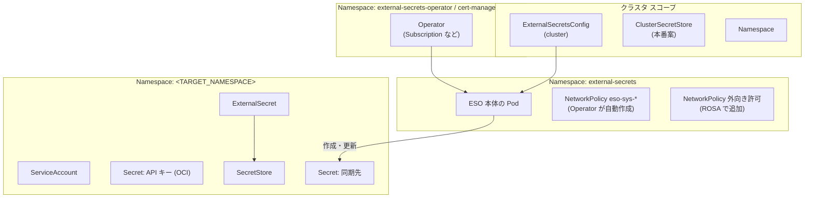

| リソース | スコープ | 置く Namespace | 作成 | 環境 | 手順書 |
|---|---|---|---|---|---|
| Operator (cert-manager / ESO の Subscription など) | Namespace | `cert-manager-operator` / `external-secrets-operator` | プラットフォーム (OperatorHub) | 共通 | §3.1・3.2 |
| ExternalSecretsConfig (`cluster`) | クラスタ | — | プラットフォーム | 共通 | §3.3 |
| ESO 本体の Pod | Namespace | `external-secrets` | 自動 (Operator) | 共通 | §3.3 |
| NetworkPolicy `eso-sys-*` (通信制限) | Namespace | `external-secrets` | 自動 (Operator)。編集しない | 共通 | ROSA §4.4.1 |
| NetworkPolicy (外向き通信の許可) | Namespace | `external-secrets` | プラットフォーム | ROSA (OCI の検証では不要) | ROSA §4.4.1 |
| Namespace | クラスタ | — | プラットフォーム | 共通 | §4 |
| ServiceAccount | Namespace | `<TARGET_NAMESPACE>` | プラットフォーム | ROSA (OCI は Workload Identity で使用予定) | ROSA §4.4.2 |
| Secret (API キー) | Namespace | `<TARGET_NAMESPACE>` (本番は 5.2.2 のとおりプラットフォーム専用の Namespace を検討) | プラットフォーム | OCI | OCI §4.3 |
| SecretStore | Namespace | `<TARGET_NAMESPACE>` | プラットフォーム | 共通 | ROSA §4.4.2 / OCI §4.4 |
| ClusterSecretStore | クラスタ | — | プラットフォーム | 本番案 (5.2.2)。検証では未使用 | — |
| ExternalSecret | Namespace | `<TARGET_NAMESPACE>` | アプリ | 共通 | ROSA §4.5 / OCI §4.5 |
| Secret (同期先) | Namespace | `<TARGET_NAMESPACE>` | 自動 (ESO) | 共通 | 同上 |

`<TARGET_NAMESPACE>` などのプレースホルダは [yaml/README.md](yaml/README.md) を参照。

## 6. 役割分担と運用設計 (案)

次の 2 チームで考える。

- **プラットフォームチーム**: クラスタの運用・CI/CD 基盤・クラウド (AWS / OCI) の管理を担う
- **アプリチーム**: アプリケーションの開発・運用を担う

**前提:** 現状、AWS Management Console / OCI の Web コンソールを操作する権限を持つのはプラットフォームチームのみ。

### 6.1 作業ごとの担当

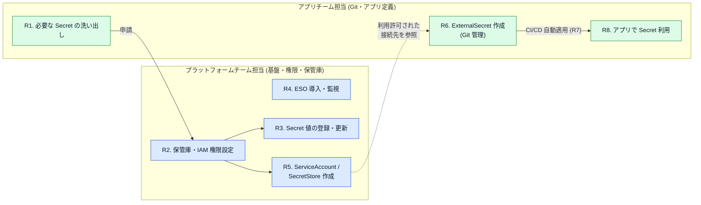

| 項番 | 作業 | プラットフォーム | アプリ |
|---|---|---|---|
| R1 | 必要な Secret の洗い出し (名前・用途・更新頻度) | 確認 | **実施** |
| R2 | 保管庫 (Vault・暗号化キー) の作成、IAM (信頼設定・ポリシー) の設定 (コンソール操作) | **実施** | |
| R3 | Secret の値の登録・更新 (ローテーション含む) | **実施** | 依頼 |
| R4 | ESO / Operator の導入・更新・監視 | **実施** | |
| R5 | アプリごとの ServiceAccount と SecretStore の作成 | **実施** | |
| R6 | ExternalSecret の作成 (Git 管理) | 不要 (※) | **実施** |
| R7 | manifest のデプロイ自動化 (CI/CD) | **実施** | 利用 |
| R8 | アプリでの Secret の利用 | | **実施** |

※ ExternalSecret はアプリの Namespace の中に作るリソースなので、アプリチームだけで作成・変更できる。プラットフォームチームが 1 件ずつ確認しなくてよいのは、**取得できる範囲が、プラットフォームチームが用意する SecretStore (R5) と保管庫側の権限 (R2) で先に決まっているため**。

### 6.2 Secret の値の受け渡し方法
チャットやメールに平文で書かないことが前提。

| 案 | 内容 | 評価 |
|---|---|---|
| A. アプリチームが保管庫に直接登録 | アプリチームに保管庫への登録権限を付与する | 受け渡しそのものが不要になる。コンソール権限の付与と、アプリ間の権限の分け方 (6.3) の決定が前提 |
| B. 開発環境から先に A を適用 | 開発環境はアプリチームが登録し、テスト・本番はプラットフォームチームが登録する | 段階的に移行できる |
| C. 既存の社内の仕組みを使う | パスワード管理ツール、アクセス制限付きのファイル共有 (パスワードは別経路) など | 社内で使えるものの棚卸しが必要 |

### 6.3 権限の設計 (OCI + Workload Identity の案)
開発・テスト・本番の各環境 (クラスタは環境ごとに分ける) を対象とする。

**OCI のリソースの関係と単位**

| リソース | 役割 | 単位・制約 | 設計案 |
|---|---|---|---|
| コンパートメント | リソースを入れるフォルダ。権限はこの単位で付けるのが基本 | 階層を作れる | 環境ごと (開発 / テスト / 本番) |
| Vault | 暗号化キーを入れる入れ物 | 1 つのコンパートメントに属する。同じコンパートメントに複数作れる | 環境ごとに 1 つ (アプリ間の分け方によっては複数。下表) |
| マスター暗号化キー | シークレットを暗号化する鍵 | 1 つの Vault の中に作る。1 つのキーで複数のシークレットを暗号化できる | Vault ごとに 1 つ |
| シークレット | 値そのもの | 作成時に「置くコンパートメント」「Vault」「キー」を選ぶ | 環境のコンパートメントに置く |

**IAM ポリシーとは**

「誰が・何に・何をしてよいか」を書いた許可の文。ポリシーはコンパートメント (またはテナンシ) に置き、その場所と下の階層に効く。

```
Allow <誰が> to <何をする> <何に> in compartment <どこで> where <条件>
```

| 要素 | 本設計で使うもの |
|---|---|
| 誰が | `group` (人のグループ) / `any-user` + 条件 (Workload Identity の ServiceAccount を条件で指定) |
| 何をする | `read` (読み取り) / `use` (利用) / `manage` (作成・変更・削除) |
| 何に | `secret-bundles` (シークレットの値) / `secret-family` (シークレット一式) / `vaults` / `keys` |

本設計のポリシー (本番の例。他の環境も同じ形):

| 対象 | ポリシー |
|---|---|
| ESO (アプリの ServiceAccount) | `Allow any-user to read secret-bundles in compartment prod where all { request.principal.type = 'identityfederateddomainapp', request.principal.name = 'system:serviceaccount:<Namespace>:<ServiceAccount>', request.principal.ext_iss = '<本番クラスタの発行者>' }` と、同じ条件で `read vaults` (ESO が SecretStore の接続確認で Vault の情報を読むため)。アプリ間で分ける場合は下表の条件を追加する |
| プラットフォームチーム | `Allow group platform-admins to manage vaults / keys / secret-family in compartment prod` (3 行) |

**アプリ間の分け方 (候補)**

| 案 | 内容 | 留意点 |
|---|---|---|
| a. シークレット名で分ける | ポリシーの条件にシークレット名 (`target.secret.name`) を加え、アプリごとに読めるシークレットを限定する | 命名規則が前提。条件の書き方は確認が必要 |
| b. Vault をアプリごとに分ける | 同じコンパートメントにアプリごとの Vault を作り、条件で Vault (`target.vault.id`) を限定する | Vault とキーの数が増える。条件として使えるかは確認が必要 |
| c. 分けない | 環境単位でのみ分ける。アプリ間は OpenShift 側 (SecretStore の作成権限) で担保する | 構成は最も簡単。IAM ではアプリを区別しない |

**権限分離の全体図**

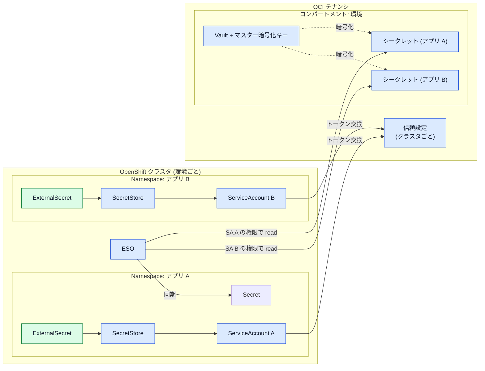
青: プラットフォームチームが管理 / 緑: アプリチームが管理

**境界ごとの分け方**

| 境界 | 分ける単位 | 担保する仕組み |
|---|---|---|
| 環境 (開発 / テスト / 本番) | クラスタ、環境のコンパートメント、Vault | クラスタごとの信頼設定と、IAM ポリシーの発行者 (`ext_iss`) の条件 |
| アプリ | Namespace、ServiceAccount | IAM ポリシーの ServiceAccount 名の条件と、上表の a〜c のいずれか |
| クラスタ内の操作 | Namespace | OpenShift の RBAC (アプリチームは自分の Namespace の中だけ操作できる) |
| 保管庫・暗号化キーの管理 | 環境のコンパートメント | IAM グループとポリシー (プラットフォームチームのみ) |

### 6.4 運用フロー (案)

**新しい Secret を追加する**

| 順 | 作業 | 担当 | 項番 |
|---|---|---|---|
| 1 | 必要な Secret (名前・用途・更新頻度) を申請 | アプリ | R1 |
| 2 | アプリを初めて載せる場合のみ: IAM ポリシー、ServiceAccount、SecretStore を各環境に用意 | プラットフォーム | R2、R5 |
| 3 | 開発 → テスト → 本番の順に値を登録 (受け渡しは 6.2) | プラットフォーム | R3 |
| 4 | ExternalSecret を Git に登録 | アプリ | R6 |
| 5 | デプロイし、Secret が作成されたことを確認 | CI/CD → アプリ | R7、R8 |

**値を更新する (ローテーション)**

| 順 | 作業 | 担当 |
|---|---|---|
| 1 | 保管庫に新しいバージョンを登録 | プラットフォーム |
| 2 | `refreshInterval` 後に Secret へ自動反映 (3.1) | (自動) |
| 3 | アプリへの反映: 環境変数で参照している場合は Pod の再起動が必要。ボリュームで参照している場合は自動で反映される | アプリ |

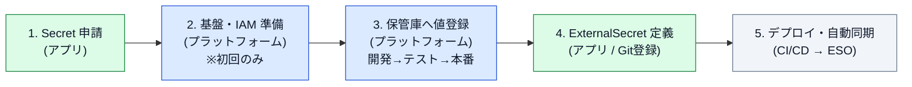

## 7. 今後の検討事項
本書の内容のうち、今後決定が必要な事項と、確認を進めている事項をまとめる。

| No. | 区分 | 事項 | 内容・現時点の案 | 状況 | 関連 |
|---|---|---|---|---|---|
| 1 | 運用 | Secret の値の受け渡し方法 | 案 A (アプリチームが保管庫に直接登録)・B (開発環境から段階的に A)・C (社内の既存の仕組み) から選ぶ | 決定が必要 | 6.2 |
| 2 | 運用 | 値の登録・更新をアプリチームに任せるか | 任せる場合は、アプリ間の分け方 (No. 5) とコンソール権限の付与が前提 | 決定が必要 | 6.1・6.2 |
| 3 | 運用 | 運用フローの確定 | 申請・承認の要否、環境ごとの担当 | 決定が必要 | 6.4 |
| 4 | 権限 | OCI のコンパートメント・Vault・キーの構成 | 環境ごとにコンパートメントを分け、Vault とキーを置く案 | 決定が必要 | 6.3 |
| 5 | 権限 | アプリ間の分け方 | a (シークレット名)・b (アプリごとの Vault)・c (分けない) から選ぶ。a・b は IAM ポリシーの条件の使い方を確認する | 決定が必要 | 6.3 |
| 6 | 認証 (OCI) | Workload Identity の OpenShift 上の ESO での利用可否 | ESO の OCI 用の Workload 設定は OKE 向けの仕組みを前提にしているため、OpenShift で利用できるかを確認する | 確認中 | 5.2.1 |
| 7 | 認証 (OCI) | クラスタの見分け方 | OpenShift の発行者 (issuer) が既定値のままだと全クラスタで同じ値になる。クラスタごとに発行者を変えるか、環境ごとにアイデンティティ・ドメインを分ける | 確認中 | 6.3 |
| 8 | 認証 (OCI) | トークン交換用の資格情報の保管 | トークン交換用アプリのクライアントシークレットの保管方法 | 確認中 | 5.2.1 |
| 9 | 認証 (OCI) | 署名鍵の変更への追従 | OpenShift の署名鍵が変わったときの信頼設定の更新方法 | 確認中 | 5.2.1 |
| 10 | 認証 (OCI) | No. 6 が困難な場合の代替 (Instance Principal) | 権限がノード単位になるため、下表の対策とあわせて評価する | 確認中 | 5.2.1 |
| 11 | 認証 (OCI) | API キー方式の専用ユーザーの単位 | 環境ごと、または環境 × アプリごと。アプリごとに分けるとアプリ間の分離を IAM で担保できるが、管理するキーが増える | 決定が必要 | 5.2.2 |
| 12 | 認証 (OCI) | API キーのローテーションの周期と実施者 | 止めずに入れ替える手順を想定。周期は社内規程に合わせる | 決定が必要 | 5.2.2 |
| 13 | 認証 (OCI) | API キーを使える場所の制限 | 通信元 IP の条件を IAM ポリシーに付けられるか (クラスタの出口 IP が固定か) | 決定が必要 | 5.2.2 |
| 14 | 認証 (OCI) | Workload Identity へ移行する条件と時期 | No. 6〜9 の確認結果を踏まえて決める | 決定が必要 | 5.2.1・5.2.2 |
| 15 | 通信 | ESO の外向き通信の宛先の絞り込み | 検証では宛先を限定せずに許可した。本番では閉域の接続経路 (VPC エンドポイント等) や宛先の制限を検討する | 決定が必要 | 5.1 |

**No. 10 (Instance Principal) を採る場合の論点**

| 論点 | 内容 |
|---|---|
| アプリ間の分離 | IAM ではアプリを区別できない (同じノードの ID で取得する)。シークレット名や Vault で分けても、ESO 経由ではすべて読める |
| SecretStore の作成権限 | SecretStore に資格情報を書かなくても接続できるため、作れる人はノードの権限をすべて使える → 作成はプラットフォームチームのみ (RBAC) とし、アプリ間の分離はここで担保する |
| 対象ノードの限定 | ESO を Infra ノード等に寄せ、Dynamic Group をそのノードだけに絞る (タグ等で指定) |
| 他の Pod からの利用 | 同じノード上の他の Pod がメタデータ (169.254.169.254) 経由で同じ権限を使えないようにする通信制御 |

## 付録: 参照ドキュメント
- [eso-rosa-verification.md](docs/eso-rosa-verification.md) — ROSA 版の手順
- [eso-oci-vault-verification.md](docs/eso-oci-vault-verification.md) — OCI 版の手順と検証結果
- [External Secrets Operator for Red Hat OpenShift (OCP 4.20)](https://docs.redhat.com/en/documentation/openshift_container_platform/4.20/html/security_and_compliance/external-secrets-operator-for-red-hat-openshift) — Red Hat 公式。動作確認済みの保管庫の一覧
- [ExternalSecret API (external-secrets.io)](https://external-secrets.io/latest/api/externalsecret/) — `refreshInterval` と `refreshPolicy` の仕様
- [Oracle Vault provider (external-secrets.io)](https://external-secrets.io/latest/provider/oracle-vault/) — OCI の認証方式 (User / Instance Principal / Workload Identity)
- [Workload Identity for Self-Managed Kubernetes (Oracle ブログ)](https://blogs.oracle.com/cloud-infrastructure/workload-identity-for-self-managed-k8s) — OCI の自己管理 Kubernetes 向け Workload Identity
- [Vault の IAM ポリシー リファレンス (OCI)](https://docs.oracle.com/en-us/iaas/Content/Identity/Reference/keypolicyreference.htm) — `secret-bundles` などのリソース種別と条件
